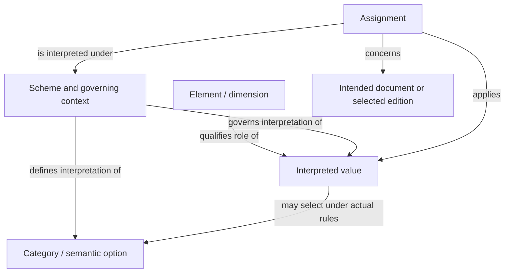
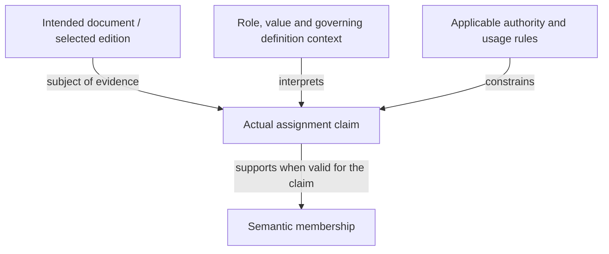

# Documentation Framework

# DF-CLS-003 — Classification Model

| Metadata | Value |
|---|---|
| **Document ID** | DF-CLS-003 |
| **Title** | Classification Model |
| **Family** | Classification |
| **Type** | Architecture |
| **Component** | Classification |
| **Author** | Arnaldo Figueira; Codex — AI assistant |
| **Status** | Draft |
| **Version** | 2.0 |
| **Revision** | 1 |
| **Baseline** | Not assigned |
| **Language** | English |

## 1. Purpose and reconstruction provenance

This document defines a working conceptual Model of Classification: the semantic roles and entities, their associations, the interpretation of documentary dimensions, assignment evidence, owner interfaces and conceptual invariants. Classification belongs to the Documentation Layer and organizes documents as knowledge independently of storage technology or physical location. Its architecture, purposes and component boundaries remain owned by DF-CLS-001; its conceptual vocabulary is developed in DF-CLS-002.

**This edition is an explicit reconstruction, not recovery of an authentic historical Model.** The received file at this path declared DF-CLS-001 — Classification Architecture, V1.0 R0, Draft, Baseline 1.0, Author Arnaldo Figueira. Its prose excluded the classification model and repeated the received Architecture. No authentic historical Model was established in the supplied corpus. The received file, original headings, complete bodies, lists, diagrams and undated Architecture history remain exact evidence attached to DF-RVW-002. Their disposition is recorded in §31. The Model sections and diagrams in this edition were newly authored by Codex — AI assistant from the reviewed sources and explicit decisions below.

The cumulative Author header preserves the evidenced original contribution to the received documentary artifact and the actual later contributor. It does not attribute all reconstructed Model text to the original author or imply either author's approval of every later change. V2.0 R1 is the working successor of the received file; it is not evidence that an authentic V1.0 Model existed. The incompatible purpose/contract replacement and monotonic Revision increment are explained in §33.

The localized identity correction is at this path only. The genuine DF-CLS-001 — Classification Architecture keeps its identifier, path and exact current bytes. DF-CLS-001 is not an alias for DF-CLS-003. There is no general replacement of Architecture references with Model references. The allocation decision and scans are attached to the review report; external allocation/reservation history remains unavailable.

## 2. Applicability and boundaries

This Model applies to the semantic organization of the actual intended documentary subjects in their declared scheme and rule context. Its normalized-document Family/Type/Class rules apply to normalized documents under the current working corpus convention. Every file named README.md, CHANGELOG.md or ArchitecturalMilestones.md, at any location, remains a non-normalized functional file; this Model does not mandate normalized fields or allocate identities to those files. They remain subject to applicable content, reference, evidence and consistency checks.

A logical document, a particular document edition, a classification definition, a semantic value, an assignment and a representation of that assignment are distinct subjects. A pre-allocation draft can be discussed without pretending it already has an assigned document key. A diagram, example or descriptor field does not establish that an assignment actually occurred. Applicable owner rules govern whether a draft may receive a classification and what subject evidence is required.

This Model defines conceptual meaning and local working invariants. It does not prescribe a database schema, serialization language, mandatory physical record, executable classifier, complete vocabulary population, general cardinality catalog, lifecycle engine, permission system or implemented integration. Detailed structural, lifecycle, validation, governance, relationship and extension rules retain their responsible sources. Missing or conflicting mandatory owner evidence prevents a broad conformance claim; it is not silently filled by a diagram or treated as an observed violation.

## 3. Authority and explicit working decisions

Current working inputs are DF-CLS-001 V2.0 R1, DF-CLS-002 V2.0 R1, common Architecture and the adopted DF-RVW-001 V1.0 R2. They establish the current normalized-document Family/Type/optional-Class meanings, stable document identity separation, responsible owner boundaries and ordinary preservation versus necessary assessed revision. This Model integrates those decisions at conceptual-model level within its own working scope. It is Draft and has no assigned Baseline or evidence of architectural acceptance.

The actual unchanged CLS-004/005/009/010/013/014 sources retain competing terminology, hierarchy and incomplete cardinality claims. Their exact clauses, editions and hashes are recorded in the accompanying evidence and §30. This edition does not declare that those sources already agree. A source's Type, filename, title, citation or catalog presence alone confers neither normative authority nor approval. Advice, examples, historical assertions, working decisions and explicitly applicable normative requirements retain their actual roles.

| Local decision | Actual previous situation | Current working decision and limit |
|---|---|---|
| Model responsibility and provenance | Received Architecture copy explicitly excluded the Model | Supply a newly authored distinct conceptual Model; preserve the copy as evidence and delegate its Architecture subjects to genuine CLS-001 |
| Entity and association distinctions | No authentic Model; Dictionary uses broader Element/category/assignment terminology | Distinguish role, governed option, interpreted value, association and context (§§4–10); map exact peer uses rather than claim completed terminology merger |
| Documentary dimensions | Unchanged detailed peers retain broad Family and Family-specific Type hierarchy | Follow current reviewed component/admitted-area Family, uniform four-value Type and optional defined Class (§§11–15); detailed propagation pending |
| Identity and interfaces | Erroneous CLS001 declaration at Model path; architectural arrows leave semantic/required roles mixed | Correct only intended Model declaration; distinguish category/assignment subjects from document K and actual provider requirements (§§16–22) |
| Evolution and claims | Received copy asserted absolute semantic/compatibility preservation and architectural implementation conformance | Use assessed necessary revision and Model-specific claim/evidence limits (§§26–28); no global acceptance or implementation claim |

## 4. Conceptual subjects and roles

The following distinctions are this Model's explicit working interpretation. They are conceptual subjects, not automatically separate persisted tables, classes, document records or newly registered components.

| Subject or role | Meaning | Distinct from |
|---|---|---|
| Intended documentary subject | Logical document, or explicitly selected edition, to which an assignment claim applies | File path, category, descriptor field or a drawn document box |
| Classification Scheme | Governed organization of semantic options and their interpretation under a declared context | Storage schema, complete populated dictionary or a classifier implementation |
| Classification Context | Applicable scheme, definitions, source editions and interpretation conditions necessary for the actual claim | A universal mandatory context-record tuple or arbitrary runtime setting |
| Classification Element | A conceptual role or dimension expressing a governed distinction; Family, Type and Class are current documentary examples | Automatically a particular category, Metadata Element or component |
| Classification Category | A defined semantic option within a declared scheme/context | Its label, definition document's key, current usage permission or population of assignments |
| Classification Value | Interpreted semantic value expressed for an Element in the actual context; it may select a category | Uninterpreted string, category identity or proof of assignment |
| Classification Assignment | Actual governed association between the intended documentary subject and interpreted value/category under applicable roles and context | Definition availability, a proposed value, Registry index row or validation result |
| Classification Membership | Semantic consequence of a valid applicable assignment | Physical containment or unconditional permission for future use |
| Definition edition | Selected version of the definition/meaning used to interpret an actual claim | Document Version by implication, label change or current lifecycle assertion |
| Classification relationship | Typed semantic association with defined endpoints and permitted interpretation | Every required-service edge, runtime call or general Relationships record |

Actual Dictionary §§6.1/6.5–6.7 defines Element as a semantic unit representing a category, Category as a grouping represented by an Element, Value as assigned to a document/context and Assignment as association with one or more Elements. Those umbrella uses are mapped to role/category/value/association as their actual context requires. This Model's distinctions do not retrospectively change that text, prove that every term is one-to-one, or claim an accepted merged canonical catalog. The exact owner reconciliation remains pending.

## 5. Typed conceptual association view

The view below is newly authored for this reconstruction. It shows semantic questions and associations; arrows do not prescribe cardinality, storage containment, allocation, authorization or required runtime services.

The compound labels group related conceptual questions for readability; Scheme and Context are not thereby one identity, and Category and Value are not thereby interchangeable. An actual assignment must establish the intended subject and applicable interpretation rather than rely on diagram topology. Membership is derived only within the claim's valid applicable association context. Omitted implementation records or lifecycle relations are not declared nonexistent.

## 6. Scheme and context

A scheme identifies how its semantic options are defined and interpreted. The governing context supplies the distinctions needed by the actual claim: which scheme and definition sources apply, which edition or effective conditions are intended, and any relevant domain, time or usage scope. The required context is claim-dependent. This is not a new universally mandatory list of physical fields or an authorization mechanism.

The same textual label in different schemes or source editions does not prove the same category, value or meaning. Conversely, two representations can express the same governed semantic option when an actual definition/mapping establishes that equivalence. Interpretation requires the applicable definitions and authority, not string equality alone.

A scheme's documented availability is not evidence that all possible options are populated, approved or currently assignable. Actual scheme membership, definition edition and lifecycle/usage rules must be checked where material. This Model does not fill an unavailable Class vocabulary or invent categories from illustrative placeholders.

## 7. Classification Element as a dimension

An Element is the conceptual role in which a classification distinction is expressed. For normalized documents, Family identifies actual component/admitted documentary-area membership, Type identifies primary documentary responsibility and Class can express an additional defined non-conflicting distinction. A role's meaning and the value represented in that role are separate.

Received Elements §36 calls its Family/Type/Class view a complete conceptual element model, while its §§6–7 preserve earlier role meanings. That is actual received peer evidence, not proof that the current role/category/assignment distinctions and every cardinality are integrated. Family, Type and Class here are neither three automatically created Metadata Elements nor three architectural components.

Other dimensions require explicit responsible definitions, applicability, relationships and compatible or justified incompatible change assessment. A new dimension does not extend the permitted Type enumeration or waive mandatory existing rules. Naming and population belong to actual definition owners; this Model does not allocate their identifiers.

## 8. Category and definition

A Category is a defined semantic option within its actual scheme/context. Its identity, definition, label, lifecycle assertion and usage are separate concerns. A definition states the option's governed meaning and scope; a readable label represents that meaning in a context and need not be its identity.

Definition evidence must be adequate for the actual interpretation claim. A category placeholder, a title in a catalog or an unqualified term is not automatically an admitted category. When a definition changes, preserve the exact prior meaning/source edition and determine whether the current change is a compatible clarification, an additive capability or an incompatible semantic revision. Neither historical interpretation nor present assignment permission follows from a label remaining unchanged.

This working distinction supports source-qualified category relationships and usage evidence without prescribing a universal category object structure, globally unique category-ID syntax or normative population of all schemes. Those require their responsible definition/schema/constraint decisions.

## 9. Value, representation and interpretation

A Value expresses a classification meaning in an Element role under an applicable context. A representation such as the string `Architecture` is interpreted as the current Type responsibility only when the governing role/context establishes that meaning. The same word in a title, directory or historical citation is not necessarily a current Type assignment.

A value may select a governed category; that relationship is not assumed to be universal one-to-one. Actual scheme/schema definitions decide whether alternate representations, combinations or additional semantic relationships are permitted. Identity, synonymy, formatting, label equivalence and semantic compatibility require their actual rules and evidence.

Representations in a Markdown header, Metadata Instance, template output, index or graph projection do not acquire authority to redefine Classification. A correction to rendering must be distinguished from a correction to assignment meaning. Meaning changes require responsible owner/consumer and compatibility assessment even when the lexical value is unchanged.

## 10. Assignment and membership

An Assignment is an actual governed association concerning an intended document and an interpreted value/category under its Element role and applicable context. For an assigned normalized document, the governing qualified document key identifies the logical subject. An edition-specific assertion also identifies the intended edition/bytes/context. Pre-allocation claims must identify their real temporary subject and limitations without inventing an assigned K.

Evidence for an actual assignment must establish the intended subject, the represented role/value and governing definition/rules/source editions, together with the authority, usage/time or decision context required by the claim. These are semantic evidence obligations, not a prescribed universal persisted tuple. The mere presence of a classification definition, a label in an example or a validation log does not establish that the association was authorized or performed.

Membership is the semantic consequence of an actual valid applicable assignment. A category's member list is not physical containment or evidence of complete population coverage. Current membership and current permission to create another assignment may differ from preserved historical membership under an earlier definition. Actual applicability and responsible rules decide the claim.

This newly authored view represents evidence and semantics. It neither performs an assignment nor equates evaluation, authorization and historical interpretation.

## 11. Family

For an applicable normalized document, Family identifies the actual canonical component or explicitly admitted non-component documentary area under current common Architecture and Review Policy §3. Component documents use the canonical name of their component; when Component is present it matches that actual membership. Current component names include Metadata, Document Identity, Classification and Templates. `DocumentIdentity` is a directory spelling, not a separate canonical component.

Foundation, Architecture and global Roadmap are admitted non-component documentary areas in their actual policy scope. The framework container is not its own component. Component roadmaps use the Family of the component they plan even when physically stored under Roadmaps. A path or allocation-series prefix does not determine Family.

Earlier broad-domain Family definitions remain exact historical or pending peer evidence. They are not an alternative simultaneous governing rule for this current normalized-document operation. This Model establishes no universal category cardinality for every other scheme or arbitrary entity from this corpus rule.

## 12. Type

Type identifies exactly one primary documentary responsibility for each applicable normalized document. Its meaning is uniform across Families.

| Type | Primary responsibility |
|---|---|
| Architecture | Foundations, principles, concepts, conceptual models/elements and architectural decisions |
| Structure | Organization, composition, schemas, structural relationships, restrictions and element catalogs |
| Behavior | Processes, lifecycle, validation, governance, extensibility and planned evolution |
| Reference | Consultation, terminology, consolidated specifications, examples, recommendations and historical records |

Use the spelling Behavior. Concepts, Model, Elements, Schema, Dictionary, Lifecycle, Base and Core are not extra Type values merely because they occur in titles or directories. Content and primary responsibility determine Type. Historical consultation is Reference; a process or planned evolution is Behavior. An applicable mixed-content document still identifies its actual primary responsibility.

Family does not create a separate Type vocabulary or redefine a Type's responsibility. Actual contextual applicability constraints may limit a particular use without redefining the meaning of the four Type values. Type=Reference alone neither grants nor removes normative authority, formal approval or publication status.

## 13. Class

Class is a separate optional semantic dimension. Its use requires an explicit definition and applicability that does not conflict with the governing Family/Type meanings or merely duplicate Type without an actual additional distinction. Absence of Class is not a defect solely because a received conceptual tuple lists it.

This Model does not establish a complete Class enumeration, universal Type→Class hierarchy, mandatory Class value or physical field. If the actual context needs a Class vocabulary or permitted combinations, the responsible definition/schema/constraint decisions must specify them with evidence. Optional does not mean an unrestricted string or a fifth Type.

Current Concepts §14 preserves the received nature/role subject but qualifies its present interpretation. Actual unchanged peers that place Class under Type remain pending source-qualified reconciliation. Neither an illustrative diagram nor this acknowledgment approves those relationships for every current assignment.

## 14. Cardinality and applicability matrix

This matrix separates adopted normalized-document obligations from unresolved general-model multiplicities. It is a local conceptual boundary; it does not replace the detailed Schema/Constraints or invent serialized field cardinalities.

| Association or question | Current justified working requirement | Remaining limit / owner |
|---|---|---|
| Applicable normalized document → Family | Use its actual canonical component or admitted documentary area; do not omit the applicable classification obligation or infer several Families from directory aliases | Exact representation and schema details remain responsible Metadata/Classification contracts |
| Applicable normalized document → Type | Exactly one primary value from the four responsibilities | No Family-specific Type enumeration or automatic Type from filename |
| Applicable normalized document → Class | Separate and optional; any value used must be explicitly defined and non-conflicting | No general maximum multiplicity or complete Class vocabulary is established here |
| Scheme → Category | Governed semantic option membership must be evidenced for the actual claim | No universal minimum/maximum population count is established |
| Element → Value / Category | Role interpretation and actual scheme rules determine the relation | No universal one-to-one or all-context mandatory mapping is established |
| Assignment → documentary subject | Every claim identifies its actual intended subject and logical-versus-edition scope | Does not forbid separately defined bulk/group operations; each actual subject association needs traceability |
| Assignment → applicable role/value/context | Actual interpretation and association evidence are required | No universal physical tuple or universal number of assigned values is established |
| Category → documentary members | Membership follows actual valid applicable assignments | No member-count bound, mandatory population or completeness claim is established |
| Semantic relationship → endpoints | Endpoint kinds, direction and actual rule scope must be explicit | Multiplicity, inverse, transitivity and acyclicity belong to the actual relation rules |
| Assigned document K → incoming external references | Population may be zero or more under the applicable DID contract | Distinct from mandatory supporting Canonical Reference descriptor for a complete assigned R |

Actual Schema §34 says complete authoritative element/cardinality rules are not established there. Relationships §20 illustrates Family1→many Type and Type1→many Class; its exact constraints are deferred to Schema/Specification. This Model does not convert those illustrations into governing uniform-Type/Class cardinalities. Specification R-013 requires the actual applicable Schema/Constraints rules, not arbitrary numbers chosen to fill a gap. Detailed missing/competing owner requirements must remain visible before a broad integrated claim.

## 15. Semantic relationships and hierarchies

Relationships within Classification have actual semantic endpoint kinds and direction. Role/value interpretation, category membership, category specialization, documentary assignment, label equivalence, supersession and deprecation are different relations. Their names or arrows are not interchangeable evidence of the same constraint.

The current normalized-document Family and Type dimensions do not form the earlier universal specialization hierarchy. Class is not universally subordinate to Type. Actual category schemes can define hierarchical or non-hierarchical relations when their responsible definitions, scope and constraints do so. There is no prohibition on every hierarchy merely because the old Family-dependent Type hierarchy is replaced.

Acyclicity applies only where the actual relation/schema rules require it. Received Relationships §43 explicitly qualifies invalid cycles by relationship type and applicable Schema. It is not proof that all semantic graphs, general Relationships, navigation or required-service dependencies are one DAG. Source/target meaning, inverse, symmetry and transitivity require their own rules; they do not follow from arrow appearance.

Where the general Relationships component records a connection, it owns connection/endpoints/provenance contracts; Classification owns the classification meaning of the connection. Projection into a Knowledge Graph cannot redefine either authority. No connection record or graph node is created by publishing this conceptual view.

## 16. Identity boundaries and localized documentary correction

Classification definition/category/value/assignment subjects are not all document identities. Their governing entity identity rules remain distinct from the identity of a normalized document that describes them. Labels, aliases and definition editions are not automatically identity coordinates. This Model allocates no universal DF document IDs to categories or assignments.

For applicable assigned normalized documents, the current qualified key K is the governing identity domain plus allocated identifier, associated with the same logical document. In this corpus the domain is Documentation Framework with prefix DF and the representation DF-SSS-NNN: registered stable three-letter uppercase allocation series and positive three-digit number 001–999. 000 is excluded. Series origin is recorded historically; current Family, Type, Component, path, Status, Version or Revision does not recalculate K.

An ordinary classification correction or repository move preserves the same document's assigned K. Allocated/retired numbers are not reused; a gap proves no availability. At 999, a traceable unused continuation series must be registered rather than widening the syntax or silently recycling. A new domain is a separate semantic decision. Historical META-DCL-001 Family/Type decomposition is not the current key-generation contract.

The erroneous received CLS001 declaration at the nominal Model path is corrected to the intended CLS003 Model allocation supported by the received catalog, historical CHANGELOG #134–135 and M6 records, plus the explicit scoped decision. Those historical assertions establish intended naming, not authentic Model content, approval or exhaustive external reservation history. Genuine CLS001 is preserved. No document that legitimately owns CLS001 is rekeyed, and no CLS001→CLS003 alias is registered. Original evidence continues to identify the received wrong declaration by its exact path and edition.

## 17. Labels, aliases and historical interpretation

A label can change without changing category identity when the responsible definition permits it; a semantic change can occur while a label stays unchanged. An alias or synonym needs actual scoped equivalence evidence and source/edition applicability. A textual resemblance or matching numeric suffix is not sufficient.

Historical labels and examples retain their original interpretation context. They must not silently resolve to another category, document or edition following a current correction. A current reference can target a logical document or an explicitly pinned edition; a pinned historical member retains its original bytes/context even when a later working successor exists.

The wrong received CLS001 header at this path is not legitimized as a semantic or documentary alias. History records the error and localized correction. Actual external integrations, consumers or caches with ambiguous unqualified CLS001 references require intended-target investigation; a global substitution would corrupt genuine Architecture references. Current operational ambiguity must be resolved before those consumers are claimed integrated.

## 18. Definition editions, usage and physical independence

A definition edition identifies the governed interpretation used by the actual assignment claim. It is not automatically the governing document's Version coordinate or a new universal record type. Applicable sources must establish the real linkage where documentary editions carry definition meaning.

Preserving an assignment's historical meaning does not automatically authorize its present use. Deprecated/retired definition evidence, current assignment permission, current membership, historical membership, reference validity and observed live retrieval are separate questions. Repositories, Registry entries, graph projections and Metadata representations may become stale while historical intended meaning remains interpretable.

Moving a file does not by itself change category identity, assigned document K or semantic membership. It can affect references, representations, indexes, adapter interfaces or access. Those actual effects require their responsible checks. Technology/format/storage independence preserves semantic ownership; it is not evidence that every representation or provider contract is unaffected by a physical change.

## 19. Metadata projection and ownership

Classification owns the meaning of its categories, roles, interpreted values, assignments and applicable classification conditions. Metadata owns descriptive element definitions and its Dictionary/Schema/Profile/Instance contracts. Representation of classification in Metadata does not transfer semantic authority to Metadata, Templates, Registry or a header parser.

For an actual applicable Metadata Instance, its governing effective Profile must be identified under the responsible Metadata contract. This Model creates neither a complete Profile nor a Classification field catalog. Family, Type, Class, scheme/context or assignment evidence here is conceptual meaning; it is not proof that corresponding Metadata Elements have canonical identifiers, complete descriptor schemas or publication/lifecycle records.

An actual projection needs intended semantic subject, source definition/rules/edition, representation mapping, applicable descriptor/profile/interface, cardinality/omission handling, provenance and checks required by that claim. Compatible rendering and semantic correction are assessed separately. An indispensable governed representation creates an actual Classification→Metadata requirement in that scope; calling it a projection does not remove the required provider.

## 20. Document Identity interfaces

Classification consumes Document Identity when an applicable assigned normalized-document subject or document endpoint must be identified. A logical-document claim uses its governing K; an exact-edition claim adds the actual edition/bytes/context. A category's identity and the key of a document describing that category remain distinct.

Current DID014 V2.0 R1 makes a local working distinction between K and complete supporting assigned record R. Complete R retains five mandatory roles: Document Identity, Identifier, Identity Domain, Identity State and Canonical Reference. Identity State/Lifecycle State is a scoped R assertion, not document Status or generic Metadata State. Canonical Reference is the intended qualified canonical target/edition descriptor, not a required incoming Relationships edge or a promise of live retrieval. K-only evidence is not full R conformity.

That exact DID specification decision is not globally accepted or fully propagated field/interface agreement. Current DID005/003/004/006/013 meanings and DF-DID-005 §11, DF-DID-010 §12, DF-DID-011 §§4.2/9 and DF-DID-013 §9 earlier-restriction references retain actual source-specific reconciliation limits. This Model consumes the needed meaning without claiming complete merged DID/Metadata schemas or silently changing those sources.

## 21. Templates, Governance and other consumers

Templates owns reusable structural definitions and applicable instance contracts. When a Classification representation actually requires a Template contract, identify that conditional Classification→Templates interface; not every assignment requires Templates. A template may expose governed fields but cannot redefine category meaning or manufacture an assignment merely by including a placeholder.

Classification owns its domain-specific conditions, definition changes and assignment semantics. Common Workflow, Policies, Reviews and Baselines retain governance contracts; actual management/approval/publication or permission execution belongs to the authorized executor and applicable DMS/tool/manual process. A CMS may manage the actual change process. This Model neither implements those systems nor transfers owner responsibility through a diagram.

Discovery consumes semantic information for organization, navigation and search. Registry catalogs registrations/index records with source/freshness evidence; it does not create entity existence or allocate document identity. Relationships records governed connections and endpoints; Knowledge Graph projects actual authoritative subjects/connections. Automation capabilities and Integration adapters need actual inputs, outputs, mapping, authorization and checks. Semantic support is not blanket permission to create, migrate, publish or retire anything.

## 22. Required interfaces and dependency assessment

Required dependency direction is consumer→provider: a consumer needs a specified contract/capability to fulfill its actual scoped responsibility. A documentary authority citation, semantic association, representation, navigation link, execution route and required provider are distinct relations. The following is selected interface scope, not a complete API or proven required graph.

| Consumer → provider / interaction | Actual scoped contract | Remaining assessment |
|---|---|---|
| Classification → Metadata | Indispensable governed classification representation/descriptor contracts where required | Exact Dictionary/Schema/Profile/Instance interfaces and conflicting current owner claims |
| Classification → Document Identity | Applicable assigned normalized-document subjects/endpoints and exact-edition interpretation | Current K/R field/interface/source propagation and actual applicability |
| Classification → Templates, conditionally | Actual indispensable structural representation contract | Establish condition and exact consumer/provider editions; no universal Template requirement |
| Validation capability consumes Classification rules | Actual domain conditions, intended subject, rule sources and evidence | Distinguish domain rule authority from real checking executor and result |
| Governance consumers use Classification meaning | Actual responsible policy/workflow/review/baseline condition | Distinguish own-domain conditions, common contract, decision and operational executor |
| Registry / Discovery / Graph consume representations | Intended subjects, interpretation and source/context/freshness | No allocation, complete population, live retrieval or authority transfer inferred |

Actual MTD001 §8.1 says Metadata depends only on Foundation and Architecture while §8.2/§12 provides support to Document Identity/Classification and other consumers. Actual DID009 §§5.1.1/10, DID014 §12 and the DID README retain Document Identity→Metadata and Metadata→Document Identity claims. These sources remain byte-unchanged. Responsible core-versus-descriptor scope, exact source editions, indispensable interfaces and cycle consequences must be assessed together. New scope names or relabeling as a projection cannot erase a genuine required cycle.

Common Foundation/Architecture supplies definitions and architecture contracts; layer support is not a mandatory serial Foundation→Architecture→Documentation→Classification execution pipeline or a requirement to depend on every earlier component. Same-layer required interfaces remain explicit and must satisfy the governing dependency rules. This selected assessment establishes neither a complete DAG nor implemented integration.

## 23. Lifecycle boundaries

Definition lifecycle and documentary usage are separate subjects. Actual CLS006 §20 proposes Defined, Active, Deprecated and Retired for classification definitions; its §§7–8 distinguishes definition lifecycle from usage. This Model preserves those source roles and does not promote a proposal to approved/implemented state machinery. The word introduced can describe an action without being a canonical state or automatic alias for Defined.

Document Status, definition lifecycle, assignment usage/current permission, identity R state assertion, review-finding state and Milestone state are distinct. No shared word makes them aliases. State/transition applicability requires actual intended subject, event/rule, authority, decision and evidence under the responsible owner contract.

Deprecation can preserve historical meaning while discouraging or restricting new usage under actual rules. It does not automatically warn, invalidate, migrate or erase every prior assignment. Retirement similarly does not silently retarget pinned definitions or document editions. Actual usage decisions and transition evidence must be preserved separately from historical interpretation.

## 24. Validation and result semantics

A Model claim identifies intended subject/population, semantic/representation/interface scope, exact source editions/artifacts/bytes/context, applicable responsible rules, authority/executor, performed and unperformed checks, observations, coverage and limits. Validation compares actual observations with applicable rules and is nonmutating; correction, assignment, permission, acceptance and formal approval require their own authorization/evidence.

Actual CLS007 §§39–42 provides Valid, Valid with Warnings and Invalid. Valid with Warnings requires no blocking rule violation and actual non-blocking findings; deprecated usage is not automatically a warning or universally invalid. Invalid requires an actual applicable blocking violation. Rule-dependent outcome meaning is not replaced by an imported DID outcome vocabulary or a selected binary diagram.

Missing, unperformed or conflicting mandatory evidence withholds a broader success claim without fabricating an observed blocking violation. Incomplete assessment and an actual invalid assignment are different conclusions. Narrow documentary checks can succeed while Model implementation, authoritative category population, full Schema/Constraints compliance or global owner integration remains unestablished.

No classification assignment, lifecycle transition or source correction is performed by a validation result. Result recording and reproducible evidence retain their actual executor and date; changing a source after a completed check requires an appropriate successor and later check rather than extending an earlier PASS to new bytes.

## 25. Governance, change authority and traceability

A proposed classification definition, association or rule change identifies its actual owner, need, rationale, alternatives, prior/new meaning, consumers, applicable authority, compatibility and transition. Actual decisions and implemented effects are recorded separately. A review command authorizes its declared documentary operation; it does not approve an architecture globally or grant operational permissions by implication.

Maintain traceability between semantic definitions, applicable source editions, intended documentary subjects, actual assignments, descriptor projections, relationship endpoints, decisions and later checks where relevant to the claim. A complete traceability claim requires actual population/coverage evidence; this conceptual list is not proof that all connections exist.

No component may silently redefine another owner's responsibility. Common Governance contracts and an actual CMS/DMS/tool/manual executor retain their own scope. This Model creates no lifecycle record, publication state, Baseline membership, category allocation or mandatory all-term consultation rule merely by listing those subjects.

## 26. Evolution and compatibility

Ordinary compatible evolution preserves applicable definitions, assigned same-document continuity and historical interpretation where feasible. Necessary assessed normative/foundational/responsibility/interface/domain revision is permitted under actual common Architecture AP-015–018 and responsible change authority; it is not automatically compatible because it is called an extension.

The received Architecture copy's §§28/31.4/35 asserted evolution without changing foundations, preservation of existing semantic meaning and unqualified architectural compatibility. Those exact previous clauses remain in the old body/view/map evidence. They are not simultaneous current rules in this reconstructed Model. Current genuine Architecture §28 explicitly replaces those absolute restrictions with ordinary preservation versus necessary assessed revision.

A necessary revision must preserve actual prior artifacts/failed checks and identify old/new rules, subject/domain/context, need, alternatives, rationale, responsible authority, owners, consumers and indispensable interfaces. Assess old→new definition/category/value/alias/assignment/reference mappings, key/domain/collision/reservation history and exact snapshot continuity. Resolve actual reciprocal requirements and transition effects rather than conceal them with relation names. Apply only the authorized scoped change with actual contributor/history evidence and later checks.

Under the working Review Policy, compatible correction retains Version; compatible additive capability increments minor; incompatible contract/convention change increments major and resets minor to0. Revision increments monotonically across Version changes. Unchanged-source validation increments neither. Real compatibility depends on permitted meaning and interfaces, not a filename correction or number alone. No arbitrary semantic mutation, allocated/retired key reuse, silent historical retargeting or automatic assignment migration follows from this evolution rule.

## 27. Local conceptual invariants

The labels below identify clauses within this working Model only. They do not allocate global constraint IDs, Metadata Elements or category identities. Detailed owner rules continue to apply to actual conformance claims.

| Local clause | Invariant / evidence obligation |
|---|---|
| M-01 | An actual assignment identifies its intended documentary subject and logical-versus-edition interpretation scope |
| M-02 | Role, category, interpreted value, label, assignment and governing context are distinguished in the actual claim |
| M-03 | Applicable normalized-document Family follows actual component/admitted-area membership; path and allocation series do not define it |
| M-04 | Applicable normalized-document Type is exactly one of Architecture, Structure, Behavior or Reference with uniform responsibility meaning |
| M-05 | Class is optional and explicitly defined when used; no universal Type→Class hierarchy or full vocabulary is inferred |
| M-06 | Interpretation and membership require applicable definition/rule/context and actual assignment evidence, not mere labels or diagrams |
| M-07 | Assigned document K remains separate from classification/entity labels and current representation; historical key/edition context is not silently retargeted |
| M-08 | Semantic associations, required providers, descriptor projections, execution and decision/approval are typed separately |
| M-09 | General multiplicity, relation properties and acyclicity require actual applicable rules; missing authority is exposed rather than invented |
| M-10 | Definition lifecycle, assignment usage, document Status, identity assertion, finding and Milestone state are separate |
| M-11 | Results identify performed checks and coverage; validation is nonmutating and narrower success does not imply broader conformance |
| M-12 | Changes preserve provenance and undergo actual authority/owner/consumer/interface/compatibility/transition assessment before propagation |

## 28. Model conformance and coverage limits

A documentary claim of alignment with this working Model must cover every applicable local invariant and actual responsible independent requirement for the declared scope. It identifies exact artifacts/source editions, intended entities/assignments/populations/interfaces, rule applicability, authority/executor, observations, performed/unperformed checks and remaining uncertainty. Choosing a convenient subset does not establish complete Model, Schema or implementation conformance.

Specification R-004 requires Classification structures to conform to DF-CLS-003, R-010 requires applicable defined Elements, R-013 requires actual Schema/Constraints cardinalities and §16.1 includes Model compliance in Core conformance. This reconstructed Draft supplies a distinct conceptual Model but does not by itself settle all unchanged owner contradictions, missing cardinalities or actual implementation evidence. Those requirements are not waived, silently rewritten or declared already satisfied.

Local documentary construction checks, later source validation, global finding closure, architectural acceptance, operational assignment permission, publication and exact Baseline inclusion remain separate events. Historical M6 completion is an input planning/history assertion, not closure of current M12/M13/M14 review work. INV-01 and REV2-05 retain their separate integrated identity/reference/content criteria; REV2-03/04/09/10 and other global records remain independently assessed.

## 29. Worked semantic cases

These cases explain the newly authored working distinctions. They create no real assignment, category, Metadata Element, key, lifecycle transition, permission or migration.

| Case | Intended interpretation | Limit / required evidence |
|---|---|---|
| This working Model document | Family Classification; Component Classification; Type Architecture; identity DF-CLS-003 in the DF domain | Header/event/diff evidence concerns this documentary correction; it does not approve the Model architecture or prove every descriptor/profile contract |
| A component roadmap stored under Roadmaps | Family follows the actual component; Type Behavior follows planned evolution responsibility | Directory is not Family; the actual document/source edition must be examined |
| The string Architecture in a header versus a title | In the applicable Type role it means primary architectural responsibility; in a title it may simply be topic text | Role/context and actual primary content matter; lexical identity alone is insufficient |
| Optional Class absent | Absence is permitted under current working convention | Any additional actual Class rules require explicit responsible context; no mandatory third tuple value is inferred |
| A category label preserved after a definition change | The same label may refer to different definition editions or changed meaning | Actual identity/source/edition/compatibility and assignment usage must be assessed |
| An old assignment under a deprecated definition | Historical interpretation can remain available while new use needs current rule/permission assessment | No automatic warning/violation/migration; actual CLS007/owner rules and observations decide the result |
| A file moved while K and meaning stay the same | Logical-document identity and semantic association can persist | Reference validity, representation/interface effects, indexes and retrieval require actual checks |
| A category has a document describing it | Category identity and the describing document's K are separate subjects | No automatic DF ID for every category or shared identity with its definition document |
| Missing complete cardinality authority | A selected conceptual role rule can be stated without pretending all relationship multiplicities are settled | Withhold broad integrated success; do not fabricate either missing numbers or an observed violation |
| Received Architecture copy at this nominal path | Preserve its exact original bytes as evidence and correct the intended distinct Model through this scoped reconstruction | Genuine CLS001 remains unchanged; no global alias/replacement or invented authentic historical Model |

## 30. Affected sources and pending coordination

The identified batch below contains the actual fifteen domain/functional paths with inbound Model references in the received REVIEW scope. Exact paths, coordinates, hashes and literal lines are external evidence. They remain byte-unchanged by this UPDATE; this is a concrete current batch, not proof that every future or external consumer is known. The broader current comparison set also retains actual Metadata/Identity/common Architecture source interfaces and remaining owner requirements.

| Source / received coordinates | Actual path | Required coordinated action and current limit |
|---|---|---|
| DF-CLS-001; V2.0 R1; Draft; Baseline Not assigned | 02-Documentation/Classification/01-Architecture/DF-CLS-001-ClassificationArchitecture.md | Qualify §39 event-time wrong-Model/current-status and prior Concepts coordinate notes by edition; retain completed cycle and exact old evidence; compared only, source unchanged |
| DF-CLS-002; V2.0 R1; Draft; Baseline Not assigned | 02-Documentation/Classification/01-Architecture/DF-CLS-002-ClassificationConcepts.md | Qualify §44 event-time missing-Model note; reconcile actual entity/role and detailed-owner interpretation without claiming prior text already updated; compared only, source unchanged |
| DF-CLS-004; V1.0 R0; Draft; Baseline 1.0 | 02-Documentation/Classification/02-Structure/DF-CLS-004-ClassificationElements.md | Assess §§6–7/12/20/23/36 role/tuple/identity/cardinality meanings against current working Model; compared only, source unchanged |
| DF-CLS-005; V1.0 R0; Draft; Baseline 1.0 | 02-Documentation/Classification/02-Structure/DF-CLS-005-ClassificationSchema.md | Reconcile §§6/11/13/19/34/45 Family/Type, tuple, historical ID and missing-cardinality authority; compared only, source unchanged |
| DF-CLS-009; V1.0 R0; Draft; Baseline 1.0 | 02-Documentation/Classification/02-Structure/DF-CLS-009-ClassificationRelationships.md | Assess §§13/20/43 hierarchy/multiplicity/acyclicity; retain relation-specific meaning and exact owners; compared only, source unchanged |
| DF-CLS-006; V1.0 R0; Draft; Baseline 1.0 | 02-Documentation/Classification/03-Behavior/DF-CLS-006-ClassificationLifecycle.md | Assess exact current Model references and actual lifecycle/validation/governance/extension/guidance/example applicability; retain responsible owner clauses; compared only, source unchanged |
| DF-CLS-007; V1.0 R0; Draft; Baseline 1.0 | 02-Documentation/Classification/03-Behavior/DF-CLS-007-ClassificationValidation.md | Assess exact current Model references and actual lifecycle/validation/governance/extension/guidance/example applicability; retain responsible owner clauses; compared only, source unchanged |
| DF-CLS-008; V1.0 R0; Draft; Baseline 1.0 | 02-Documentation/Classification/03-Behavior/DF-CLS-008-ClassificationGovernance.md | Assess exact current Model references and actual lifecycle/validation/governance/extension/guidance/example applicability; retain responsible owner clauses; compared only, source unchanged |
| DF-CLS-010; V1.0 R0; Draft; Baseline 1.0 | 02-Documentation/Classification/03-Behavior/DF-CLS-010-ClassificationConstraints.md | Reconcile §§12–14/26–28 normalized dimensions, category identity and actual cardinality requirements; compared only, source unchanged |
| DF-CLS-011; V1.0 R0; Draft; Baseline 1.0 | 02-Documentation/Classification/03-Behavior/DF-CLS-011-ClassificationExtensibility.md | Assess exact current Model references and actual lifecycle/validation/governance/extension/guidance/example applicability; retain responsible owner clauses; compared only, source unchanged |
| DF-CLS-012; V1.0 R0; Draft; Baseline 1.0 | 02-Documentation/Classification/04-Reference/DF-CLS-012-ClassificationBestPractices.md | Assess exact current Model references and actual lifecycle/validation/governance/extension/guidance/example applicability; retain responsible owner clauses; compared only, source unchanged |
| DF-CLS-013; V1.0 R0; Draft; Baseline 1.0 | 02-Documentation/Classification/04-Reference/DF-CLS-013-ClassificationDictionary.md | Reconcile §§6.1/6.5–6.7 broader Element/category/value/assignment terminology and exact authority/population limits; compared only, source unchanged |
| DF-CLS-014; V1.0 R0; Draft; Baseline 1.0 | 02-Documentation/Classification/04-Reference/DF-CLS-014-ClassificationSpecification.md | Assess R-004/R-010/R-013 and §16.1 actual mandatory Model/Elements/cardinality/Core scope; do not grant full implementation conformity; compared only, source unchanged |
| DF-CLS-015; V1.0 R0; Draft; Baseline 1.0 | 02-Documentation/Classification/04-Reference/DF-CLS-015-ClassificationExamples.md | Assess exact current Model references and actual lifecycle/validation/governance/extension/guidance/example applicability; retain responsible owner clauses; compared only, source unchanged |
| README.md; Non-normalized functional file | 02-Documentation/Classification/README.md | Assess current Model link and actual Type/owner/reference claims as a functional file; no normalization or automatic approval; compared only, source unchanged |

Genuine Architecture V2.0 R1 §39 and Concepts V2.0 R1 §44 contain their event-time missing-Model/wrong-declaration notes and prior coordinate rows. At their exact completed cycle dates, those observations described the received nominal file. This separately traced Model UPDATE now changes that file; their historical event scopes remain, but current normative/current-status statements need version-qualified coordination before claiming integrated agreement. They are not silently amended, automatically revalidated or reopened here. The Architecture note about received Concepts V1.0 R0 likewise retains its previously documented coordination requirement.

Actual current Elements/Schema/Constraints role meanings, Dictionary broader terminology, Relationships multiplicities and Specification owner requirements remain visible. Domain semantics/descriptor definitions stay with their responsible owners. Actual Metadata representation and reciprocal Identity requirements also need full source-edition/interface assessment. This Model cannot claim full schema, vocabulary, graph, lifecycle, implementation or architectural acceptance from its own source presence.

## 31. Disposition of the received Architecture copy

The following map preserves every original numbered heading and exact title as received evidence. Those are headings of the received Architecture copy, not alleged historical Model chapters. The current authoritative Architecture responsibility remains at the same-numbered section of genuine DF-CLS-001 V2.0 R1; actual changed interpretations there govern that source. The Model contribution identified alongside is newly authored, not recovered historical text. Full old bodies/lists/header/history and per-view label/relation/disposition maps are attached to DF-RVW-002.

| Received section | Exact received heading title | Current Architecture subject / new Model disposition |
|---|---|---|
| 1 | Introduction | Genuine CLS001 §1 retains Architecture responsibility; newly authored Model §§1–3 |
| 2 | Purpose | Genuine CLS001 §2 retains Architecture responsibility; newly authored Model §§1–3/7–10 |
| 3 | Scope | Genuine CLS001 §3 retains Architecture responsibility; newly authored Model §§2–3/28 |
| 4 | Architectural Position | Genuine CLS001 §4 retains Architecture responsibility; newly authored Model §§1/21–22 |
| 5 | Architectural Role | Genuine CLS001 §5 retains Architecture responsibility; newly authored Model §§4/19–22 |
| 6 | Architectural Responsibility | Genuine CLS001 §6 retains Architecture responsibility; newly authored Model §§1/4/19–22 |
| 7 | Classification as a Semantic Capability | Genuine CLS001 §7 retains Architecture responsibility; newly authored Model §§2/18 |
| 8 | Classification and Knowledge | Genuine CLS001 §8 retains Architecture responsibility; newly authored Model §§1/4–10 |
| 9 | Classification and Documents | Genuine CLS001 §9 retains Architecture responsibility; newly authored Model §§2/4/10/14 |
| 10 | Responsibilities | Genuine CLS001 §10 retains Architecture responsibility; newly authored Model §§2–4/30 |
| 11 | Non-Responsibilities | Genuine CLS001 §11 retains Architecture responsibility; newly authored Model §§2/19–25 |
| 12 | Relationship with Metadata | Genuine CLS001 §12 retains Architecture responsibility; newly authored Model §§19/22 |
| 13 | Relationship with Document Identity | Genuine CLS001 §13 retains Architecture responsibility; newly authored Model §§16/20 |
| 14 | Relationship with Templates | Genuine CLS001 §14 retains Architecture responsibility; newly authored Model §§21–22 |
| 15 | Relationship with Governance | Genuine CLS001 §15 retains Architecture responsibility; newly authored Model §§21/25 |
| 16 | Relationship with Discovery | Genuine CLS001 §16 retains Architecture responsibility; newly authored Model §§21 |
| 17 | Relationship with Relationships | Genuine CLS001 §17 retains Architecture responsibility; newly authored Model §§15/21 |
| 18 | Relationship with Registry | Genuine CLS001 §18 retains Architecture responsibility; newly authored Model §§21 |
| 19 | Relationship with Validation | Genuine CLS001 §19 retains Architecture responsibility; newly authored Model §§24/28 |
| 20 | Architectural Dependencies | Genuine CLS001 §20 retains Architecture responsibility; newly authored Model §§22 |
| 21 | Required Supporting Capabilities | Genuine CLS001 §21 retains Architecture responsibility; newly authored Model §§19–22 |
| 22 | Architectural Boundaries | Genuine CLS001 §22 retains Architecture responsibility; newly authored Model §§2–4/30 |
| 23 | Architectural Independence | Genuine CLS001 §23 retains Architecture responsibility; newly authored Model §§18 |
| 24 | Modularity | Genuine CLS001 §24 retains Architecture responsibility; newly authored Model §§25–26 |
| 25 | Separation of Responsibilities | Genuine CLS001 §25 retains Architecture responsibility; newly authored Model §§19–25 |
| 26 | Knowledge Orientation | Genuine CLS001 §26 retains Architecture responsibility; newly authored Model §§1/4–10 |
| 27 | Traceability | Genuine CLS001 §27 retains Architecture responsibility; newly authored Model §§10/16–18/25 |
| 28 | Extensibility | Genuine CLS001 §28 retains Architecture responsibility; newly authored Model §§26 |
| 29 | Architectural Evolution | Genuine CLS001 §29 retains Architecture responsibility; newly authored Model §§28/30–31 |
| 30 | Architectural Principles | Genuine CLS001 §30 retains Architecture responsibility; newly authored Model §§3/25–28 |
| 31 | Architectural Characteristics | Genuine CLS001 §31 retains Architecture responsibility; newly authored Model §§18/22/25–26 |
| 31.1 | Modular | Genuine CLS001 §31.1 retains Architecture responsibility; newly authored Model §§2/21 |
| 31.2 | Layered | Genuine CLS001 §31.2 retains Architecture responsibility; newly authored Model §§1/22 |
| 31.3 | Traceable | Genuine CLS001 §31.3 retains Architecture responsibility; newly authored Model §§10/25 |
| 31.4 | Extensible | Genuine CLS001 §31.4 retains Architecture responsibility; newly authored Model §§26 |
| 31.5 | Technology Independent | Genuine CLS001 §31.5 retains Architecture responsibility; newly authored Model §§18 |
| 31.6 | Knowledge-Oriented | Genuine CLS001 §31.6 retains Architecture responsibility; newly authored Model §§1/4–10 |
| 32 | Architectural Model | Genuine CLS001 §32 retains Architecture responsibility; newly authored Model §§4–5/14 |
| 33 | Component Interaction Model | Genuine CLS001 §33 retains Architecture responsibility; newly authored Model §§19–22 |
| 34 | Architectural Authority | Genuine CLS001 §34 retains Architecture responsibility; newly authored Model §§3/19–25 |
| 35 | Architectural Constraints | Genuine CLS001 §35 retains Architecture responsibility; newly authored Model §§14–16/22/26–28 |
| 36 | Conformance | Genuine CLS001 §36 retains Architecture responsibility; newly authored Model §§27–28 |
| 37 | Classification Component Documentation | Genuine CLS001 §37 retains Architecture responsibility; newly authored Model §§30/32 |
| 38 | Related Documents | Genuine CLS001 §38 retains Architecture responsibility; newly authored Model §§30/32 |
| 38.1 | Foundation | Genuine CLS001 §38.1 retains Architecture responsibility; newly authored Model §§3/26/32 |
| 38.2 | Architecture | Genuine CLS001 §38.2 retains Architecture responsibility; newly authored Model §§3/22/26/32 |
| 38.3 | Documentation Layer | Genuine CLS001 §38.3 retains Architecture responsibility; newly authored Model §§19–22/32 |
| 38.4 | Classification | Genuine CLS001 §38.4 retains Architecture responsibility; newly authored Model §§30/32 |

The eighteen original unnamed diagrams are preserved exactly in the evidence, with their original section anchors and SHA-256 digests. Every textual label/relation line and its current Architecture interpretation/Model disposition is mapped. No original diagram ID is invented. They remain Architecture views; the two Mermaid views in this Model are newly authored conceptual/evidence views.

| Received Architecture section | Original view identifier | Preserved meaning and current disposition |
|---|---|---|
| 4 | Unnamed; no received ID | Allocation of areas and four Documentation peers; not a serial service sequence or required-edge direction.; exact view/labels retained in evidence, newly authored Model §§1/21–22 |
| 5 | Unnamed; no received ID | Three owner capabilities contribute to the document; no mandatory joined runtime object, storage layout or ownership transfer.; exact view/labels retained in evidence, newly authored Model §§4/19–22 |
| 9 | Unnamed; no received ID | Selected logical-document aspect associations; not universal fields, multiplicity or complete accepted schema.; exact view/labels retained in evidence, newly authored Model §§2/4/10/14 |
| 12 | Unnamed; no received ID | Metadata description and document classification association; actual required Classification→Metadata scope is separately stated.; exact view/labels retained in evidence, newly authored Model §§19/22 |
| 13 | Unnamed; no received ID | Two distinct capabilities about one document; ordinary classification change does not reconstruct governing K.; exact view/labels retained in evidence, newly authored Model §§16/20 |
| 14 | Unnamed; no received ID | Template representation and semantic assignment; no mandatory Template runtime route or classification authority transfer.; exact view/labels retained in evidence, newly authored Model §§21–22 |
| 15 | Unnamed; no received ID | Allocation plus meaning provision to Governance area; not automatic decision/approval or implemented workflow.; exact view/labels retained in evidence, newly authored Model §§21/25 |
| 16 | Unnamed; no received ID | Selected semantic support to Discovery capabilities; Knowledge Discovery label allocates no new component or obligatory stage.; exact view/labels retained in evidence, newly authored Model §§21 |
| 17 | Unnamed; no received ID | Selected participation/connection; exact typed endpoint/provenance and indispensable interface must be separately declared.; exact view/labels retained in evidence, newly authored Model §§15/21 |
| 18 | Unnamed; no received ID | Classification data provision to registrations; Registry owns records, not existence/meaning or allocations of every entity.; exact view/labels retained in evidence, newly authored Model §§21 |
| 19 | Unnamed; no received ID | Domain rule provision and evaluation of an assignment; structural required direction/executor/permission are not granted by data flow.; exact view/labels retained in evidence, newly authored Model §§24/28 |
| 20 | Unnamed; no received ID | Common support/allocation context, not mandatory Foundation→Architecture→Documentation→Classification execution.; exact view/labels retained in evidence, newly authored Model §§22 |
| 22 | Unnamed; no received ID | Fourteen own-domain documentary subjects inside a boundary, not fourteen installed services or complete authentic sources.; exact view/labels retained in evidence, newly authored Model §§2–4/30 |
| 26 | Unnamed; no received ID | Knowledge/documentation/document/classification subject and organization relations, not four allocated runtime components.; exact view/labels retained in evidence, newly authored Model §§1/4–10 |
| 29 | Unnamed; no received ID | Fifteen intended documentary stages; genuine Model is unresolved and historical M6 is distinct from current M12 review.; exact view/labels retained in evidence, newly authored Model §§28/30–31 |
| 32 | Unnamed; no received ID | Allocation and selected capability contributions; omitted Templates or detailed obligations are not waived by the view.; exact view/labels retained in evidence, newly authored Model §§4–5/14 |
| 33 | Unnamed; no received ID | Selected representation/semantic/rule interaction; not a compulsory pipeline or denial of genuine required providers.; exact view/labels retained in evidence, newly authored Model §§19–22 |
| 34 | Unnamed; no received ID | Qualified semantic meaning provision and representation/consumption; not universal ownership or automatic dependency direction.; exact view/labels retained in evidence, newly authored Model §§3/19–25 |

All original list subjects, the fifteen-row component catalog, fifteen-ID M6 progression and thirty-one related subjects across four groups remain in exact input evidence and mapped Architecture responsibilities. The original initial-history entry remains verbatim in §33 with its true Architecture description and no invented issue date. This disposition preserves provenance without leaving a second operative Architecture contract masquerading as a Model.

## 32. Related sources and their roles

| Source / actual edition | Responsibility and authority limit |
|---|---|
| [DF-ARC-001 — Architecture Overview](../../../01-Architecture/DF-ARC-001-ArchitectureOverview.md); V2.0 R2 | Common architectural concepts, principles, allocation, terminology and documentation responsibility; actual clause/edition authority applies |
| [DF-ARC-002 — Architectural Principles](../../../01-Architecture/DF-ARC-002-ArchitecturalPrinciples.md); V2.0 R2 | Common architectural concepts, principles, allocation, terminology and documentation responsibility; actual clause/edition authority applies |
| [DF-ARC-003 — Architectural Concepts](../../../01-Architecture/DF-ARC-003-ArchitecturalConcepts.md); V2.0 R2 | Common architectural concepts, principles, allocation, terminology and documentation responsibility; actual clause/edition authority applies |
| [DF-ARC-004 — Architectural Layers](../../../01-Architecture/DF-ARC-004-ArchitecturalLayers.md); V2.0 R2 | Common architectural concepts, principles, allocation, terminology and documentation responsibility; actual clause/edition authority applies |
| [DF-ARC-005 — Architectural Components](../../../01-Architecture/DF-ARC-005-ArchitecturalComponents.md); V2.0 R2 | Common architectural concepts, principles, allocation, terminology and documentation responsibility; actual clause/edition authority applies |
| [DF-ARC-006 — Terminology](../../../01-Architecture/DF-ARC-006-Terminology.md); V2.0 R2 | Common architectural concepts, principles, allocation, terminology and documentation responsibility; actual clause/edition authority applies |
| [DF-ARC-007 — Component Documentation Structure](../../../01-Architecture/DF-ARC-007-ComponentDocumentationStructure.md); V2.0 R2 | Common architectural concepts, principles, allocation, terminology and documentation responsibility; actual clause/edition authority applies |
| [DF-CLS-001 — Classification Architecture](DF-CLS-001-ClassificationArchitecture.md); V2.0 R1 | Current reviewed working Architecture/Concepts; unchanged event-time missing-Model notes require later coordinated qualification |
| [DF-CLS-002 — Classification Concepts](DF-CLS-002-ClassificationConcepts.md); V2.0 R1 | Current reviewed working Architecture/Concepts; unchanged event-time missing-Model notes require later coordinated qualification |
| [DF-CLS-003 — Classification Model](DF-CLS-003-ClassificationModel.md); V2.0 R1 | This newly reconstructed working Model; Draft and pending source validation, not a recovered historical Model |
| [DF-CLS-004 — Classification Elements](../02-Structure/DF-CLS-004-ClassificationElements.md); V1.0 R0 | Actual detailed Classification owner/guidance/example source as applicable; competing role/cardinality/terminology/approval evidence remains source-qualified |
| [DF-CLS-005 — Classification Schema](../02-Structure/DF-CLS-005-ClassificationSchema.md); V1.0 R0 | Actual detailed Classification owner/guidance/example source as applicable; competing role/cardinality/terminology/approval evidence remains source-qualified |
| [DF-CLS-006 — Classification Lifecycle](../03-Behavior/DF-CLS-006-ClassificationLifecycle.md); V1.0 R0 | Actual detailed Classification owner/guidance/example source as applicable; competing role/cardinality/terminology/approval evidence remains source-qualified |
| [DF-CLS-007 — Classification Validation](../03-Behavior/DF-CLS-007-ClassificationValidation.md); V1.0 R0 | Actual detailed Classification owner/guidance/example source as applicable; competing role/cardinality/terminology/approval evidence remains source-qualified |
| [DF-CLS-008 — Classification Governance](../03-Behavior/DF-CLS-008-ClassificationGovernance.md); V1.0 R0 | Actual detailed Classification owner/guidance/example source as applicable; competing role/cardinality/terminology/approval evidence remains source-qualified |
| [DF-CLS-009 — Classification Relationships](../02-Structure/DF-CLS-009-ClassificationRelationships.md); V1.0 R0 | Actual detailed Classification owner/guidance/example source as applicable; competing role/cardinality/terminology/approval evidence remains source-qualified |
| [DF-CLS-010 — Classification Constraints](../03-Behavior/DF-CLS-010-ClassificationConstraints.md); V1.0 R0 | Actual detailed Classification owner/guidance/example source as applicable; competing role/cardinality/terminology/approval evidence remains source-qualified |
| [DF-CLS-011 — Classification Extensibility](../03-Behavior/DF-CLS-011-ClassificationExtensibility.md); V1.0 R0 | Actual detailed Classification owner/guidance/example source as applicable; competing role/cardinality/terminology/approval evidence remains source-qualified |
| [DF-CLS-012 — Classification Best Practices](../04-Reference/DF-CLS-012-ClassificationBestPractices.md); V1.0 R0 | Actual detailed Classification owner/guidance/example source as applicable; competing role/cardinality/terminology/approval evidence remains source-qualified |
| [DF-CLS-013 — Classification Dictionary](../04-Reference/DF-CLS-013-ClassificationDictionary.md); V1.0 R0 | Actual detailed Classification owner/guidance/example source as applicable; competing role/cardinality/terminology/approval evidence remains source-qualified |
| [DF-CLS-014 — Classification Specification](../04-Reference/DF-CLS-014-ClassificationSpecification.md); V1.0 R0 | Actual detailed Classification owner/guidance/example source as applicable; competing role/cardinality/terminology/approval evidence remains source-qualified |
| [DF-CLS-015 — Classification Examples](../04-Reference/DF-CLS-015-ClassificationExamples.md); V1.0 R0 | Actual detailed Classification owner/guidance/example source as applicable; competing role/cardinality/terminology/approval evidence remains source-qualified |
| [DF-FND-001 — Framework Manifest](../../../00-Foundation/DF-FND-001-FrameworkManifest.md); V2.0 R1 | Foundation context, actual common definitions/evolution and historical decisions; exact clause role and current working edition apply |
| [DF-FND-002 — Research Journal](../../../00-Foundation/DF-FND-002-ResearchJournal.md); V1.0 R1 | Foundation context, actual common definitions/evolution and historical decisions; exact clause role and current working edition apply |
| [DF-FND-003 — Evolution Timeline](../../../00-Foundation/DF-FND-003-EvolutionTimeline.md); V1.0 R1 | Foundation context, actual common definitions/evolution and historical decisions; exact clause role and current working edition apply |
| [DF-FND-004 — Architectural Blueprint](../../../00-Foundation/DF-FND-004-ArchitecturalBlueprint.md); V2.0 R1 | Foundation context, actual common definitions/evolution and historical decisions; exact clause role and current working edition apply |
| [DF-FND-005 — Framework Evolution](../../../00-Foundation/DF-FND-005-FrameworkEvolution.md); V1.0 R1 | Foundation context, actual common definitions/evolution and historical decisions; exact clause role and current working edition apply |
| [DF-FND-006 — Design Rationale](../../../00-Foundation/DF-FND-006-DesignRationale.md); V2.0 R1 | Foundation context, actual common definitions/evolution and historical decisions; exact clause role and current working edition apply |
| [DF-MTD-001 — Metadata Architecture](../../Metadata/01-Architecture/DF-MTD-001-MetadataArchitecture.md); V1.0 R0 | Actual descriptor/model/schema/profile/instance authority in its declared scope; no automatic Classification field catalog or cycle resolution |
| [DF-RVW-001 — Review Policy](../../../03-Governance/Reviews/03-Behavior/DF-RVW-001-ReviewPolicy.md); V1.0 R2 | User-adopted working process/classification/identity/provenance/edition conventions; not global architectural approval |
| [DF-DID-014 — Document Identity Specification](../../DocumentIdentity/04-Reference/DF-DID-014%20-%20Document%20Identity%20Specification.md); V2.0 R1 | Actual document-identity K/R and interface meanings; local contract decisions and pending source propagation are not global acceptance |
| [DF-DID-009 — Document Identity Relationships](../../DocumentIdentity/02-Structure/DF-DID-009%20-%20Document%20Identity%20Relationships.md); V2.0 R1 | Actual document-identity K/R and interface meanings; local contract decisions and pending source propagation are not global acceptance |
| [DF-MTD-003 — Metadata Model](../../Metadata/01-Architecture/DF-MTD-003-MetadataModel.md); V1.0 R0 | Actual descriptor/model/schema/profile/instance authority in its declared scope; no automatic Classification field catalog or cycle resolution |
| [DF-MTD-005 — Metadata Schema](../../Metadata/02-Structure/DF-MTD-005-MetadataSchema.md); V1.0 R0 | Actual descriptor/model/schema/profile/instance authority in its declared scope; no automatic Classification field catalog or cycle resolution |
| [DF-MTD-013 — Metadata Dictionary](../../Metadata/02-Structure/DF-MTD-013-MetadataDictionary.md); V1.0 R0 | Actual descriptor/model/schema/profile/instance authority in its declared scope; no automatic Classification field catalog or cycle resolution |
| [DF-MTD-014 — Metadata Specification](../../Metadata/04-Reference/DF-MTD-014-MetadataSpecification.md); V1.0 R0 | Actual descriptor/model/schema/profile/instance authority in its declared scope; no automatic Classification field catalog or cycle resolution |
| Document Identity component; Templates component | Original two component-level related subjects retained; actual identified source/contract applicability governs their interfaces (§§20–22), not a nonexistent component-level normalized document |

The original related-source subjects comprised all six Foundation documents, seven common Architecture documents, Metadata Architecture, the Document Identity and Templates components, and all fifteen Classification documents: thirty-one subjects, twenty-nine distinct document IDs plus two component subjects. They remain explicit in the received evidence and disposition map. Current actual source editions and selected-clause scope are recorded externally; listing or linking them does not prove complete conformance, normative authority, publication or Baseline membership.

## 33. Edition history

**Verbatim initial history received in the wrong Architecture copy:**

| Version | Description |
|---------|-------------|
| 1.0 | Initial definition of the Classification architecture. |

The received record has no original issue date. Its V1.0 R0, Draft, Baseline 1.0 and original Author declarations are historical evidence for the received file only; they do not establish an authentic historical Model, approval or a successor's Baseline membership.

| Date | Version | Revision | Event / actual contributor | Scope and compatibility |
|---|---|---|---|---|---|
| 2026-10-16 | 2.0 | 1 | Step4.31 UPDATE; Codex — AI assistant | Explicitly reconstructed conceptual Model and path-scoped correction of erroneous CLS001/Architecture to intended CLS003/Model. Original Architecture evidence and Arnaldo Figueira attribution preserved; new Model content authored by Codex. Incompatible purpose/contract replacement, major 1→2/minor 0 and monotonic Revision 0→1 under Policy §5.2. Draft; Baseline Not assigned; all14 local corrections pending separate VALIDATE. Report §103; CHANGELOG532–534. |

The major increment reflects replacement of permitted purpose/contract and introduction of an actual working entity/association/invariant model, including current role/authority/evolution meanings; a header-only correction would not justify that assessment. No completed intermediate edition or fabricated historical Model R0 is claimed. Later unchanged-source validation keeps these coordinates and records its exact outcome centrally. No architecture approval, operational implementation, assignment/migration/retirement, publication or exact Baseline inclusion is performed by this UPDATE.

**End of Document**
